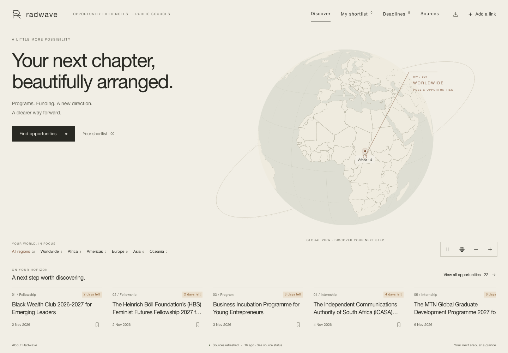

# Radwave

**Your next chapter, beautifully arranged.**

**Live app: [radwave.vercel.app](https://radwave.vercel.app)**

A Go-powered crawler and a calm, human-friendly dashboard for programs, scholarships, fellowships, grants, internships, competitions, and other opportunities around the world.

## An opportunity workspace, beautifully placed

Inspired by Sinnogram's spatial layout, Radwave combines a warm paper palette, a quiet top navigation, a geographic globe, and an opportunity workspace that opens on the right. The horizon strip keeps current announcements close; the workspace holds search, filters, your shortlist, deadlines, and source updates.

The globe uses self-hosted MapLibre GL JS and public-domain Natural Earth country outlines. Clicking a region filters opportunities by their discovery labels. Region markers are approximate exploration points, not program locations or confirmation of country eligibility. The interface also works through text filters when WebGL is unavailable.

## One feed, more signals

The [original Twitter scraper](https://github.com/YeandAmen/twitter-scrapper) now feeds Radwave's shared opportunity pipeline alongside LinkedIn, RSS, and publisher articles. Search watchlists, profiles, posts, engagement histories, and channel filters live in one workspace. Automatic X discovery requires X API access and credits; pasted announcements can be imported now.

[Setup & usage guide](docs/guide.md) · [Architecture](docs/architecture.md)
